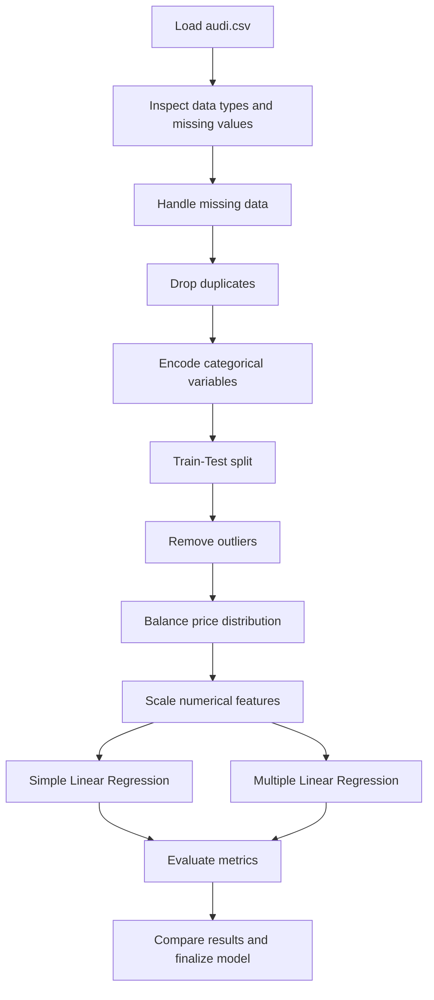
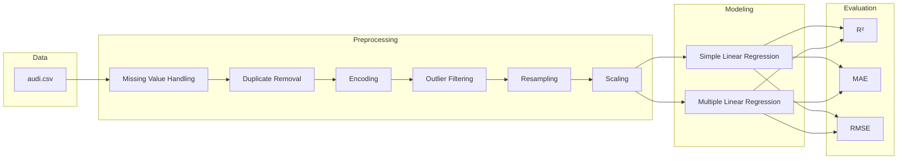

# Audi Price Regression

A machine learning project for predicting used Audi car prices from historical sales data. The project explores data cleaning, preprocessing, feature engineering, and regression modeling using Python, Pandas, scikit-learn, and Jupyter Notebook.

## Overview

This repository analyzes the `audi.csv` dataset and builds a regression pipeline to estimate the price of used Audi vehicles based on features such as:

- Model
- Year
- Mileage
- Transmission
- Fuel type
- Tax
- MPG
- Engine size

The goal is to build a reliable price prediction model and compare the performance of different regression approaches.

## Project Goal

Predict the resale market value of Audi cars using a structured dataset and evaluate model performance using common regression metrics such as:

- R² Score
- Mean Absolute Error (MAE)
- Root Mean Squared Error (RMSE)

## Dataset

The dataset is stored in:

- `audi.csv`

### Dataset shape

- Rows: 1,921
- Features: 9 columns
- Target variable: `price`

### Features

| Column | Description |
|---|---|
| model | Audi model name |
| year | Manufacturing year |
| price | Vehicle selling price |
| transmission | Automatic / Manual / Semi-auto |
| mileage | Distance traveled |
| fuelType | Diesel / Petrol / Hybrid / Electric |
| tax | Tax value |
| mpg | Miles per gallon |
| engineSize | Engine capacity |

## Data Cleaning and Preparation

The notebook performs the following preprocessing steps:

- Load the dataset
- Inspect column types and missing values
- Fill missing numerical values using median imputation
- Fill missing categorical values using mode imputation
- Remove duplicate rows
- Encode categorical variables using `LabelEncoder`
- Split data into train/test sets
- Remove outliers based on pricing thresholds
- Address class imbalance in the target variable using bin-based oversampling
- Standardize numerical features using `StandardScaler`

## Modeling Approach

The project evaluates two regression models:

1. Simple Linear Regression
   - Uses the strongest correlated feature with `price`
2. Multiple Linear Regression
   - Uses all relevant features after preprocessing

## Model Performance

The notebook reports the following performance results on the test set:

| Model | R² | MAE | RMSE |
|---|---:|---:|---:|
| Simple Linear Regression | 0.455 | 5264.42 | 7354.35 |
| Multiple Linear Regression | 0.830 | 2930.04 | 4111.68 |

### Interpretation

The multiple linear regression model significantly outperforms the simple model, demonstrating that combining multiple vehicle characteristics yields a much more reliable price prediction.

## Repository Structure

```text
Audi_price_regression/
├── Regression.ipynb     # Main notebook containing all analysis and modeling
├── audi.csv             # Used Audi price dataset
├── .gitattributes       # Git attributes configuration
└── README.md            # Project overview and documentation
```

## Workflow Diagram



## Pipeline Architecture



## Model Comparison Diagram

```mermaid
barChart
    title Model Performance Comparison
    x-axis [Simple Linear, Multiple Linear]
    y-axis "R² Score" 0 --> 1
    Simple Linear: 0.455
    Multiple Linear: 0.830
```

## Setup Instructions

### Prerequisites

- Python 3.9+
- Jupyter Notebook / JupyterLab
- pip

### Install dependencies

```bash
pip install pandas numpy matplotlib seaborn scikit-learn jupyter
```

### Run the notebook

```bash
jupyter notebook Regression.ipynb
```

## How to Use This Project

1. Open `Regression.ipynb` in Jupyter.
2. Run all cells in sequence.
3. Review the preprocessing steps and model evaluation output.
4. Use the trained model to estimate prices for new Audi listings.

## Key Insights

- Vehicle age is a major factor in pricing.
- Mileage strongly affects resale value.
- Engine size and fuel efficiency also contribute to the final price.
- Multiple features together provide a much stronger prediction signal than a single-variable model.

## Future Improvements

Possible next steps for this project include:

- Testing alternative regression models such as:
  - Random Forest Regressor
  - Gradient Boosting
  - XGBoost
  - CatBoost
- Adding cross-validation for more robust evaluation
- Tuning model hyperparameters
- Creating a reusable prediction function for real-world pricing use cases
- Building a web app or dashboard for interactive price estimation

## License

This project is intended for educational and data science exploration use. If you plan to reuse or adapt it, check whether your environment or organization requires a specific open-source license.

## Contact

For questions or suggestions, please open an issue or discuss improvements in the repository.

---

This project demonstrates a complete end-to-end regression workflow using a real-world used-car pricing dataset and provides a practical example of preprocessing, balancing, feature scaling, and model evaluation in Python.


